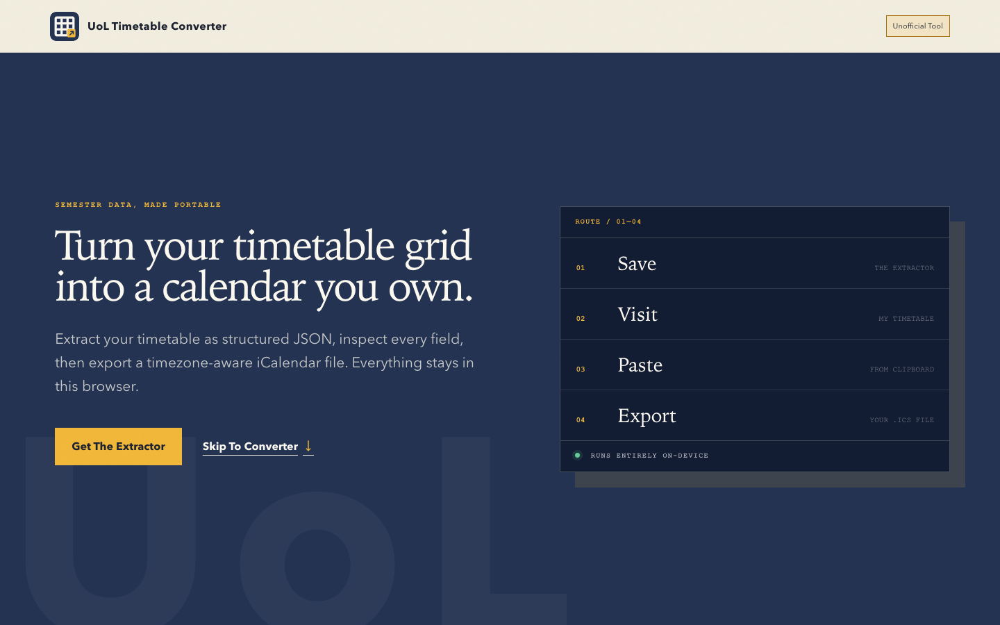
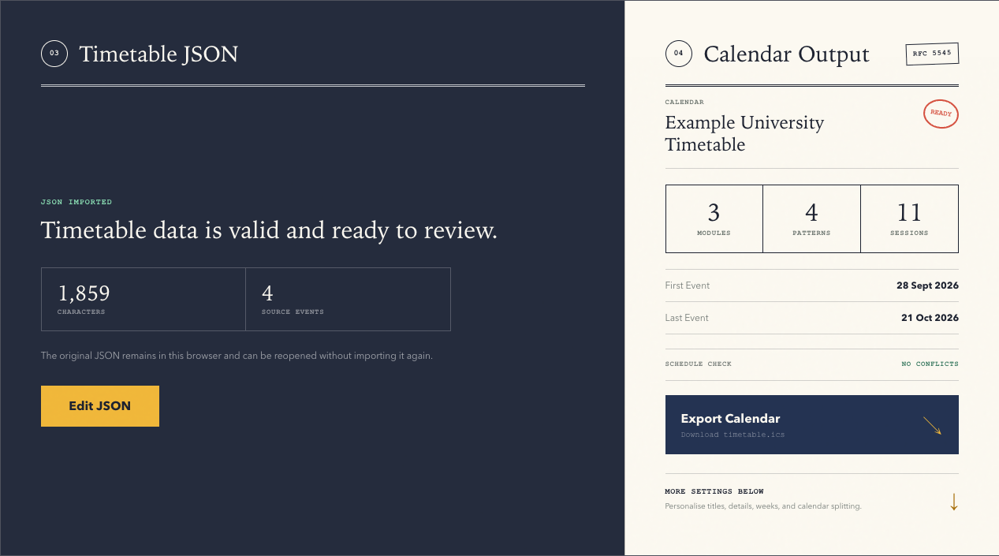

# UoL Timetable Converter

[](https://github.com/GeniusLv2006/uol-timetables/actions/workflows/ci.yml)
[](LICENSE)

[English](README.md) | **简体中文**

将利物浦大学（University of Liverpool）**My Timetable** 中的课表转换为标准日历文件，支持导入 Google 日历、Apple 日历、Outlook 等日历应用。

**在线使用：<https://timetables.xjtlu.uk>**

所有处理均在本地浏览器中完成：课表不会上传，无需安装软件，也无需注册账号。



> [!IMPORTANT]
> 本项目为**非官方独立工具**，与利物浦大学（University of Liverpool）及西交利物浦大学（XJTLU）均无关联，未经其认可，也不由其运营。`xjtlu.uk` 为个人注册的域名，并非学校官方网站。课表信息以 My Timetable 为准，重要课程请务必在 My Timetable 中核对。

网站界面为英文。下文中的**粗体英文**为页面上按钮或选项的原文，便于对照查找。本文如与[英文版](README.md)存在出入，以英文版为准。

## 功能

- **一键复制课表**：书签仅需保存一次，此后单击即可复制。
- **生成 `.ics` 日历文件**：准确还原日期、时间、教室与教学周，并自动处理英国夏令时与冬令时的切换。
- **导出前自定义**：可调整事件标题、课程简称、提醒及所含课程，并可按课程拆分为多个日历。
- **自动检测问题**：如重复课程、时间冲突等。



## 使用方法

建议在电脑上使用 Chrome、Edge、Firefox 或 Safari。

### 1. 保存提取书签（仅需一次）

打开 <https://timetables.xjtlu.uk>，将金色的 **Copy UoL Timetable** 按钮拖动到浏览器书签栏。

若书签栏未显示，请先将其打开（Windows 和 Linux 按 `Ctrl+Shift+B`，Mac 按 `Cmd+Shift+B`）。若无法拖动，请单击 **Copy Bookmarklet Code**，然后手动新建书签，并将复制的代码粘贴到书签的网址栏中。

### 2. 复制课表

1. 登录 [My Timetable](https://timetables.liverpool.ac.uk/)。
2. 单击左下角菜单中的 **View Semester 1** 或 **View Semester 2**。
3. 单击书签栏中的 **Copy UoL Timetable**，页面将提示课表已复制。

若浏览器不允许访问剪贴板，课表将改为以 `.json` 文件形式下载。

### 3. 粘贴到转换器

返回 <https://timetables.xjtlu.uk>，将课表粘贴到 **Timetable JSON** 输入框中（`Ctrl+V` 或 `Cmd+V`），或将下载的 `.json` 文件拖入其中。检查预览并按需调整设置后，单击 **Export Calendar** 并确认，即可下载 `.ics` 日历文件。

### 4. 导入日历应用

建议导入到**单独新建的日历**中（例如命名为“Semester 1”）。课表变动时，只需删除该日历并重新导入，不会影响其他日程。

| 应用 | 导入方法 |
| --- | --- |
| Google 日历 | 在电脑上打开 **设置 → 导入和导出 → 导入**，选择 `.ics` 文件及目标日历。 |
| Apple 日历（Mac） | 选择 **文件 → 导入**，然后选择 `.ics` 文件。 |
| iPhone 或 iPad | iOS 不支持从“文件”App 直接导入已下载的 `.ics` 文件。请先在“日历”App 中新建日历，再将文件通过邮件发送给自己，然后在“邮件”App 中打开附件并添加其中的日程。 |
| Outlook | 网页版：选择 **添加日历 → 从文件上传**。桌面版：直接打开 `.ics` 文件。 |

## 隐私

- 课表、日历文件及已保存的设置仅存储在本地浏览器中，不会发送至本网站或任何第三方。
- 提取书签仅读取页面上显示的课表，绝不读取密码、Cookie 或登录信息。
- 本网站使用 Cloudflare Web Analytics 统计访问量。该服务不使用跟踪 Cookie，也无法查看课表内容。如需关闭统计，请使用页面底部的 **Privacy** 链接。

## 常见问题

**单击书签后提示 “No timetable table was found on this page”**
请确认当前页面是显示整个学期课表的 My Timetable 页面（见第 2 步），而非登录页或菜单页。

**日期相差一周，或复活节后的课程有误**
转换器以学期第一个教学周的周一（“Week One”）为基准推算日期。第一学期的日期已内置；第二学期的教学周因复活节假期而中断，因此尚未内置。请在 **Schedule** 设置中手动填写 Week One，并对照 My Timetable 核对复活节后的课程。

**课表变动后如何更新？**
导出的日历仅为快照，不会自动同步。请重新复制课表并导出新文件，在日历应用中删除旧日历后再导入。

**所有课程均相差一小时**
请检查 **Schedule** 设置中的时区，通常应为 `Europe/London`。日历应用会自动按你所在的时区显示时间。

**是否支持手机？**
在手机上保存书签较为不便，建议使用电脑。获得 `.ics` 文件后，可在任意设备上导入。

**如何反馈问题？**
欢迎[提交 issue](https://github.com/GeniusLv2006/uol-timetables/issues/new/choose)（中英文均可）。请勿附上真实课表，因其包含个人日程信息；描述问题或使用虚构数据即可。

## 自定义选项

加载课表后，可在以下四个标签页中调整日历：

- **Naming**（命名）：事件标题格式、课程简称、日历名称、文件名及建议颜色。
- **Details**（详情）：事件描述的显示内容、提醒及地点格式。
- **Schedule**（日程）：Week One、时区、学期起止日期、所含教学周、阅读周，以及导出为重复事件还是单独事件。
- **Delivery**（授课形式）：所含课程类型（讲座、研讨课等），以及导出为单个日历，还是按课程或课程类型拆分为多个日历。

上述设置可在浏览器中保存为命名的**配置**（profile），供下学期继续使用。配置仅保存格式偏好，日期始终以加载的课表为准。

## 命令行转换器

熟悉终端的用户也可使用 `convert_to_ical.py`，将复制的 JSON 转换为与网站默认设置完全一致的日历文件，仅需 Python 3：

```bash
python3 convert_to_ical.py timetable.json timetable.ics
```

与网站不同，该脚本未内置各学期的 Week One 日期，因此 JSON 中必须包含 `weekOneMonday`；此外，脚本仅支持 `Europe/London` 时区。详见 [JSON 格式说明](docs/timetable-json.md)（英文）。

## 开发者

```bash
npm install
npm run dev    # 本地预览
npm run check  # 测试、构建及部署预检
```

开发文档均为英文：[贡献指南](CONTRIBUTING.md)、[维护指南](docs/MAINTAINING.md)、[JSON 格式说明](docs/timetable-json.md)、[安全策略](SECURITY.md)。

## 许可证

Copyright © 2026 Tingkai Lyu.

本项目采用 [GNU Affero 通用公共许可证 v3.0（仅限此版本）](LICENSE)（`AGPL-3.0-only`）授权。你可以使用、研究、修改和分享本项目。若分发修改后的版本，或将其作为网站或其他网络服务运行，须依照同一许可证向用户提供完整源代码。

许可证仅涵盖代码，不包括项目名称及本站域名。许可证的法律文本以英文原文为准。
